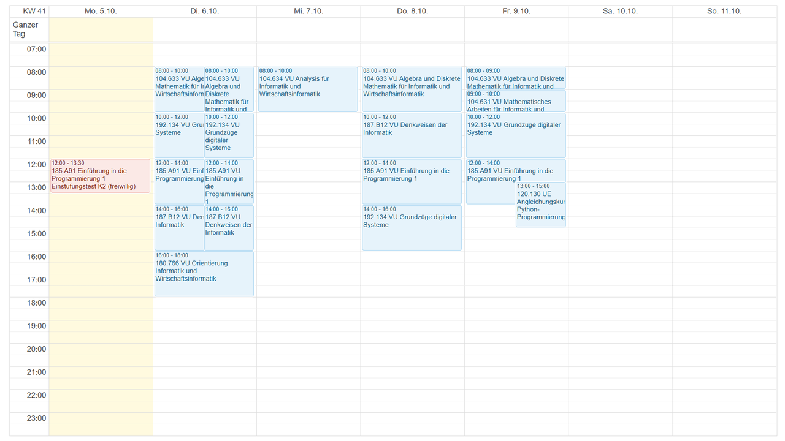

Seit Oktober 2026 studiere ich **Informatik an der [TU Wien](/tuwien/)** (Bachelor 033 521). Das Semester hat am Donnerstag, 1. Oktober, angefangen, die erste volle Woche war KW 41, vom 5. bis 9. Oktober.

<!-- TODO(O4): Einstieg: Wie war der erste Tag? Erster Eindruck von der TU? -->

## Der Auftakt

Die ersten zwei Tage waren noch ruhig:

- **Donnerstag, 1. Oktober:** Orientierung Informatik und Wirtschaftsinformatik, 9 bis 12 Uhr
- **Freitag, 2. Oktober:** die erste Einheit Einführung in die Programmierung 1, danach Grundzüge digitaler Systeme

## Die erste volle Woche

| Tag | Uhrzeit | Lehrveranstaltung |
|---|---|---|
| Mo, 5.10. | 12:00–13:30 | EP1: Einstufungstest K2 (freiwillig) |
| Di, 6.10. | 8–10 | Algebra und Diskrete Mathematik |
| | 10–12 | Grundzüge digitaler Systeme |
| | 12–14 | Einführung in die Programmierung 1 |
| | 14–16 | Denkweisen der Informatik |
| | 16–18 | Orientierung Informatik und Wirtschaftsinformatik |
| Mi, 7.10. | 8–10 | Analysis |
| Do, 8.10. | 8–10 | Algebra und Diskrete Mathematik |
| | 10–12 | Denkweisen der Informatik |
| | 12–14 | Einführung in die Programmierung 1 |
| | 14–16 | Grundzüge digitaler Systeme |
| Fr, 9.10. | 8–9 | Algebra und Diskrete Mathematik |
| | 9–10 | Mathematisches Arbeiten |
| | 10–12 | Grundzüge digitaler Systeme |
| | 12–14 | Einführung in die Programmierung 1 |
| | 13–15 | Angleichungskurs Python-Programmierung |

Ohne den Test sind das 28 Stunden an Lehrveranstaltungsterminen, die meisten am Dienstag mit zehn Stunden am Stück. Am Freitag überschneiden sich EP1 und der Python-Kurs um eine Stunde.

<!-- TODO(O4): Welche Termine hast du wirklich besucht (vor Ort, Aufzeichnung, gar nicht)? Wie hast du die Überschneidung am Freitag gelöst? -->

Wie der Einstufungstest am Montag ausgegangen ist, steht in einem eigenen Beitrag: [Einstufungstest K2: freiwillig, aber lohnend?](/blog/einstufungstest-k2/)

## Die acht Lehrveranstaltungen

| Nr. | Lehrveranstaltung | |
|---|---|---|
| 185.A91 | Einführung in die Programmierung 1 | [EP1](/tuwien/ep1/) |
| 192.134 | Grundzüge digitaler Systeme | [GDS](/tuwien/gds/) |
| 104.633 | Algebra und Diskrete Mathematik für Informatik und Wirtschaftsinformatik | [ADM](/tuwien/adm/) |
| 104.634 | Analysis für Informatik und Wirtschaftsinformatik | [Analysis](/tuwien/analysis/) |
| 104.631 | Mathematisches Arbeiten für Informatik und Wirtschaftsinformatik | [Math. Arbeiten](/tuwien/mathematisches-arbeiten/) |
| 187.B12 | Denkweisen der Informatik | [Denkweisen](/tuwien/denkweisen/) |
| 180.766 | Orientierung Informatik und Wirtschaftsinformatik | [Orientierung](/tuwien/orientierung/) |
| 120.130 | Angleichungskurs Python-Programmierung | [Python](/tuwien/python-angleichung/) |

Alle sind VUs (Vorlesung mit Übung), bis auf den Python-Kurs, der ist eine reine Übung (UE).

<!-- TODO(O4): Pro LVA ein Satz zum ersten Eindruck? Oder nur die zwei, die am meisten überrascht haben. -->

## Nach einer Woche

<!-- TODO(O4): Persönlicher Teil: Wie fühlt sich der Alltag an (Pendeln, Uni neben Ehrenamt und mo-tion)? Was ist anders als an der HTL? Was hast du nach einer Woche schon gelernt? -->

---

- [TU Wien](/tuwien/)
- [TU Wien im Portfolio](/portfolio/2026-10-01-tuwien/)
