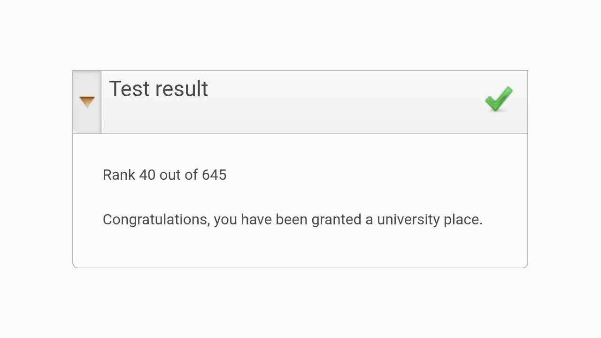
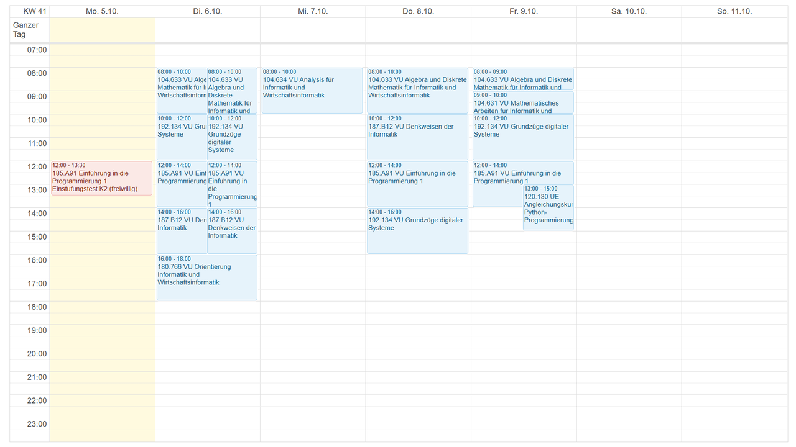



Seit Oktober 2026 studiere ich **Informatik (Bachelor, 033 521) an der TU Wien**.

## Aufnahmeverfahren

Für Informatik gibt es an der TU Wien ein Aufnahmeverfahren in drei Schritten:

| Datum | Schritt |
|---|---|
| 01.04.2026 | Anmeldung, Daten vervollständigen |
| 02.04.2026 | Registrierung mit Online-Self-Assessment |
| 13.07.2026 | Reihungstest |

Ergebnis: **Rang 40 von 645**, Studienplatz zugeteilt.

## Lehrveranstaltungen

Zu jeder Lehrveranstaltung gibt es eine eigene Seite mit Steckbrief, Inhalt, dem, was ich gelernt habe, und eigenen Übungen. Nur eigene Notizen und eigener Code, keine Folien und keine Prüfungsangaben.




### WintersemesterSommersemester {{ jahr }}

<table>
  <thead><tr><th>Nr.</th><th>Typ</th><th>Lehrveranstaltung</th><th>SWS</th><th>ECTS</th><th>Status</th></tr></thead>
  <tbody>
  
  
    
    <tr>
      <td>{{ l.lva_nr }}</td>
      <td>{{ l.typ }}</td>
      <td><a href="{{ l.url | relative_url }}">{{ l.title }}</a></td>
      <td>{{ l.sws }}–</td>
      <td>{{ l.ects }}–</td>
      <td>{{ l.status }}</td>
    </tr>
  
    <tr><td></td><td></td><th>Summe</th><th>{{ sum_sws }}</th><th>{{ sum_ects }}</th><td></td></tr>
  </tbody>
</table>


## Die erste Woche

So sah mein Kalender in der ersten Studienwoche aus (KW 41, 5.–11. Oktober 2026):

[TU Wien im Portfolio](/portfolio/2026-10-01-tuwien/){: .btn .btn--inverse}
